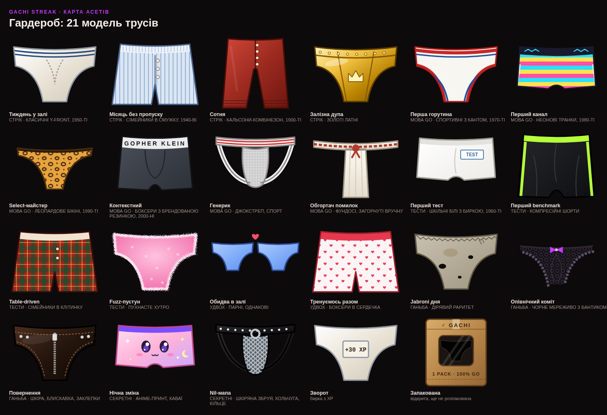

# Біблія Gachi Streak

Головний документ проєкту: про що гра, який у неї тон і за якими правилами живе гардероб. Якщо інший документ чи код суперечить цьому файлу, виправляють одне з двох, а не залишають розбіжність. Технічні деталі лежать в окремих документах, посилання на них наприкінці.

## Що це

Двоє людей щодня вчать Go і стережуть стрік одне одного. Кожен день до місцевої півночі треба зарахувати хоча б одне заняття: кнопкою, локальним комітом або push на GitHub. Пропуск карається публічно. Десктоп-клієнт міняє шпалери на покарання, і стрік згорає до нуля.

Поверх стріку є гра: XP, ранги і ачівки. Кожна ачівка — це **окрема модель чоловічих трусів**, яку треба заробити, а потім розпакувати.

## Тон

- **Gachi-гумор, а не пошлість.** Меми (♂, «Boy Next Door», «Dungeon Master», «Boss of This Gym») є, анатомії немає. Труси завжди схематичний одяг, ніколи не тіло.
- **Ганьба весела, а не принизлива.** Провали мають свої ачівки й ефекти. Вони смішні для обох, і ніхто не почувається зацькованим.
- **Двоє — це команда.** Duo-ачівки і статистика напарника мотивують, а не змагають до виснаження.
- **Мова інтерфейсу:** українська, а англійська як друга. Технічні правила ачівок пишемо мовою Go (`AST: go statement`).

## Гра в цифрах

| Що | XP |
|---|---|
| Зарахований день | +30 |
| Відкрита ачівка | +XP ачівки |
| Пропущений дедлайн | −50 |

Ранг — це сумарний XP, тож його можна втратити. Сім рангів: Slave → Jabroni → Boy Next Door → Performance Artist → Boss of This Gym → Deep Dark Gopher → Dungeon Master. Деталі в [gamification.md](gamification.md).

## Гардероб

Карта асетів вище — еталон того, як виглядає кожна модель. Код моделей лежить у [`frontend/src/briefs.tsx`](../frontend/src/briefs.tsx).

### Канон

1. **Одна ачівка — одна модель.** Моделі не повторюються, і в кожної свій силует або принт.
2. **Від класики до сучасності.** Що легша ачівка, то старша й простіша модель (кальсони 1900-х, Y-front 1950-х). Що рідкісніша, то сучасніша й зухваліша (мереживо, шкіра, аніме, метал).
3. **Модель натякає на ачівку.** Table-driven отримує клітинку (таблицю), Fuzz — хутро, Error wrapper — загорнуте фундосі, Сотня — кальсони столітньої давності, Повернення — шкіру.
4. **Ганьба зношена.** Ганебні моделі або старі й діряві, або «надто відверті для пристойного залу».
5. **Секретні — найекзотичніші.** Їх не видно навіть силуетом, доки не відкриті.
6. **Справжні кольори тканини.** Відкрита модель має власні кольори (біла бавовна, золото, шкіра), а не колір теми.
7. **Технічна рамка:** поле 200×160, тільки SVG без растрових картинок, і модель має читатися навіть як іконка 44 px.

### Каталог

| Ачівка | id | Категорія | XP | Модель |
|---|---|---|---|---|
| Тиждень у залі | `streak_7` | стрік | 30 | Класичні Y-front, 1950-ті |
| Місяць без пропуску | `streak_30` | стрік | 100 | Сімейники в смужку, 1940-ві |
| Сотня | `streak_100` | стрік | 300 | Кальсони-комбінезон, 1900-ті |
| Залізна дупа | `streak_365` | стрік | 1000 | Золоті латні |
| Перша горутина | `goroutine` | Go | 40 | Спортивні з кантом, 1970-ті |
| Перший канал | `channel` | Go | 40 | Неонові транки, 1980-ті |
| Select-майстер | `select` | Go | 50 | Леопардове бікіні, 1990-ті |
| Контекстний | `context` | Go | 60 | Боксери «GOPHER KLEIN», 2000-ні |
| Генерик | `generics` | Go | 60 | Джокстреп |
| Обгортач помилок | `errwrap` | Go | 40 | Фундосі, загорнуті вручну |
| Перший тест | `first_test` | тести | 40 | Шкільні білі з биркою «TEST», 1960-ті |
| Перший benchmark | `benchmark` | тести | 60 | Компресійні шорти |
| Table-driven | `table_test` | тести | 50 | Сімейники в клітинку |
| Fuzz-пустун | `fuzz` | тести | 80 | Пухнасте хутро |
| Обидва в залі | `duo_7` | удвох | 50 | Парні, однакові |
| Тренуємось разом | `duo_30` | удвох | 120 | Боксери в сердечка |
| Jabroni дня | `first_fail` | ганьба | 0 | Дірявий раритет |
| Опівнічний коміт | `midnight` | ганьба | 5 | Чорне мереживо з бантиком |
| Повернення | `comeback` | ганьба | 40 | Шкіра, блискавка, заклепки |
| Нічна зміна | `night_owl` | секретні | 30 | Аніме-принт, каваї |
| Nil-мапа | `nil_map` | секретні | 50 | Шкіряна збруя, кольчуга, кільце |

### Стани ачівки

| Стан | Як виглядає |
|---|---|
| Закрита | пунктирний силует своєї моделі із замком |
| Секретна закрита | загальний силует зі знаком питання, форма прихована |
| Відкрита, не розпакована | картонна пачка «♂ GACHI» з віконцем, у якому видно темний силует; підстрибує, бейдж «Розпакуй!» |
| Розпакована | модель у повному кольорі; у переглядачі крутиться вліво чи вправо від кліку |
| Зворот | та сама тканина з биркою, на якій XP |

### Розпаковка

Перше відкриття — це ритуал зі звуком. Для звичайних ачівок ефект випадковий: **Розпаковка** (пачка рветься, конфеті), **Кольоровий спін** (силует заливається кольором) або **Gachi-флекс** (падіння з ударом і написом за рідкістю). Ганебні ачівки завжди отримують **Ганьбу**: глітч, сумний тромбон і штамп. Розпаковка буває один раз і зберігається на сервері. Деталі в [gamification.md](gamification.md#розпаковка).

## Як додати нову ачівку з моделлю

1. **Правило і XP:** каталог `Achievements` у [`internal/progress/progress.go`](../internal/progress/progress.go). Ачівка за код потребує також детектора в [`internal/codescan`](../internal/codescan/codescan.go) з тим самим id.
2. **Тексти:** `ach` (назва, опис) і `briefs` (назва моделі) обома мовами в [`frontend/src/i18n.ts`](../frontend/src/i18n.ts).
3. **Назва для десктоп-сповіщень:** `achievementNames` у [`internal/client/achievements.go`](../internal/client/achievements.go). Тест упаде, якщо її немає.
4. **Модель:** запис у `MODELS` у [`frontend/src/briefs.tsx`](../frontend/src/briefs.tsx) за каноном вище.
5. **Перевірка:** `go test ./...` і `npx tsc --noEmit`, далі `make unlock-all NAME=<ти>` і подивитись картку, переглядач і розпаковку.
6. **Карта асетів:** перезняти `docs/assets/briefs-map.png` і додати рядок у каталог цього файлу.

## Інші документи

- [architecture.md](architecture.md) — як влаштовані сервер і клієнт
- [gamification.md](gamification.md) — XP, ранги, детектори ачівок, розпаковка
- [frontend.md](frontend.md) — веб-застосунок і API
- [deploy-fly.md](deploy-fly.md) — деплой
